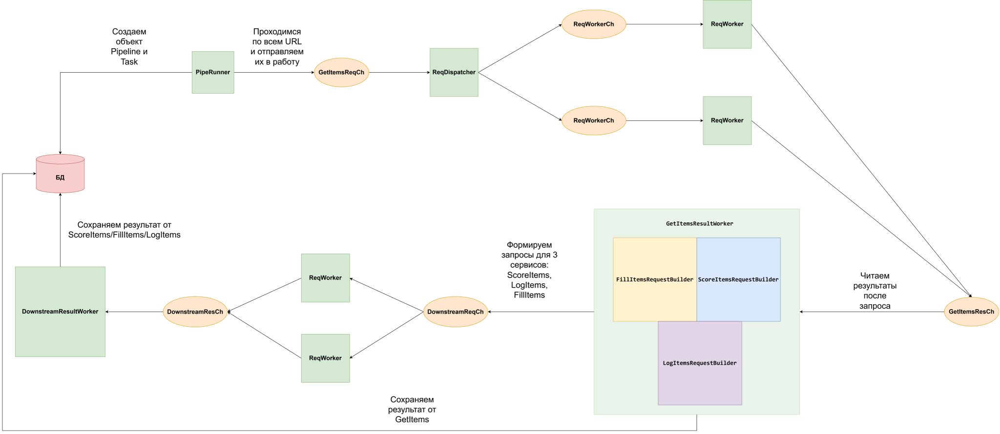

# Pipeline Processing Pet Project

Pet-project на Go для практики построения конкурентного pipeline обработки большого количества HTTP-запросов.

Проект охватывает работу с goroutines, channels, worker pool, fan-out, backpressure, graceful shutdown и обработку ошибок при взаимодействии с внешними сервисами и БД.

**Стек:** Go, PostgreSQL, Docker, Bun

<details>
<summary><strong>1. Техническое задание</strong></summary>

Необходимо реализовать сервис для обработки большого количества URL(1 млн).

На вход сервис получает список URL. Для каждого URL создается отдельная задача обработки (`PipelineTask`).

```
requests_samples = [
('http://some-service/getItems/', {'user_id': 100}),  # вернет {item_ids: [1, 2, 3]}
('http://some-service/getItems/', {'user_id': 101}),
...
]
```

Обработка одной задачи состоит из нескольких стадий:

1. Выполнить запрос для каждого исходного URL(стадия `GetItems`) и получить список `item_ids`.
2. На основании полученных `item_ids` сформировать и выполнить три независимых запроса:
    - `FillItems`;
    - `ScoreItems`;
    - `LogItems`.
3. Результат выполнения каждой стадии сохранить в PostgreSQL.

Каждая стадия завершается со статусом success или failed.

Задача (PipelineTask) считается успешно завершенной, если успешно выполнены все четыре стадии:

- GetItems;
- FillItems;
- ScoreItems;
- LogItems.

Если хотя бы одна из стадий завершается с ошибкой, задача считается неуспешной.

Один запуск обработки всего списка URL представляет собой Pipeline. После завершения обработки всех задач необходимо определить их итоговые статусы и завершить Pipeline.
</details>

<details>
<summary><strong>2. Цели проекта</strong></summary>

Основная цель проекта — на практике разобраться с конкурентностью в Go и подходами к организации обработки большого количества независимых задач.

В рамках проекта хочется разобраться с:

- конкурентным выполнением задач с помощью goroutines;
- взаимодействием goroutine через channels;
- синхронизацией и координацией нескольких goroutine;
- управлением жизненным циклом goroutine;
- реализацией backpressure в Go;
- распространением сигнала отмены через `context.Context`;
- корректным закрытием channels при наличии нескольких producer-ов и consumer-ов;

</details>

<details>
<summary><strong>3. Упрощения</strong></summary>

Проект является учебным, поэтому в текущей реализации намеренно сделан ряд упрощений:

- pipeline запускается для одного пользователя;
- список исходных URL уже находится в памяти;
- pipeline запускается вручную;
- используются два HTTP-pool-а по два воркера: один для `GetItems`, второй для `FillItems`, `ScoreItems` и `LogItems`;
- разные схемы входных каналов в pool-ах используются для учебной практики.

Количество worker-ов намеренно не конфигурируется и не масштабируется динамически: на текущем этапе важно показать сам принцип организации конкурентной обработки, а не подобрать оптимальную степень параллелизма.

</details>

<details>
<summary><strong>4. Устройство проекта</strong></summary>

<details>
<summary><strong>4.1 Общая архитектура</strong></summary>



Pipeline состоит из двух последовательных групп обработки: `GetItems` и downstream-стадий (`FillItems`, `ScoreItems`, `LogItems`). У каждой группы свой worker pool и свой канал результатов.

1. `Runner` создает `Pipeline` и `PipelineTask` в БД и отправляет начальные запросы в `getItemsReqCh`.
2. `DispatchRequests` распределяет их по отдельным входным каналам двух HTTP-воркеров.
3. Воркеры выполняют `GetItems` и отправляют результаты в `getItemsResCh`.
4. `GetItemsResultWorker` сохраняет результаты в БД. После успешного `GetItems` с непустым списком `item_ids` формирует три запроса и отправляет их в `downstreamReqCh`.
5. Два downstream-воркера читают общий `downstreamReqCh`, выполняют запросы и отправляют результаты в `downstreamResCh`.
6. `DownstreamResultWorker` сохраняет результаты downstream-стадий в БД.
7. `Runner` ожидает завершения всех компонентов и финализирует статусы в БД.

Запросы следующих стадий поступают в отдельный pool. Обратной отправки в очередь `GetItems` нет: поток обработки не образует цикл ожидания через заполненные каналы.

### Два способа организации worker pool

Разные схемы входных каналов выбраны **намеренно, для практики обоих подходов**.

| Pool | Входные каналы | Распределение работы |
| --- | --- | --- |
| `GetItems` | У каждого воркера свой канал: `firstReqWorkerCh`, `secondReqWorkerCh` | `DispatchRequests` отправляет запрос в один из доступных каналов |
| Downstream | Один общий `downstreamReqCh` на двух воркеров | Свободный воркер получает следующий запрос непосредственно из общего канала |

При чтении общего канала один запрос получает один воркер. Канал не рассылает копии всем consumer-ам. Каждый pool отправляет результаты в свой общий канал результатов.

Буферизированные каналы обеспечивают backpressure: если следующий компонент не успевает, заполнение каналов приостанавливает отправителей. Нормальная обработка продолжается по мере освобождения места.

</details>

<details>
<summary><strong>4.2 Основные компоненты</strong></summary>

### Runner

`Runner.Run` управляет одним запуском pipeline:

1. создает `Pipeline` в БД;
2. создает задачи для исходных URL и отправляет `GetItems`;
3. закрывает `getItemsReqCh` после завершения отправки, в том числе при досрочной ошибке;
4. ожидает завершения всех goroutine через `ExecutionWaiter`;
5. при успешном завершении ожидания и активном контексте обновляет итоговые статусы задач и завершает `Pipeline`.

При ошибке создания pipeline или отправки начальных запросов `Runner` отменяет общий контекст и дожидается завершения компонентов перед возвратом ошибки.

### DispatchRequests

Распределяет только запросы `GetItems` между двумя входными каналами воркеров. Завершается при закрытии входа или отмене контекста и закрывает оба выходных канала.

### RequestWorker

Выполняет HTTP-запрос через `Requester` и передает `RequestResult` дальше. Один и тот же тип используется в обоих pool-ах: различаются подключенные входные и выходные каналы.

### GetItemsResultWorker

Сохраняет `StageResult` для `GetItems`, извлекает `item_ids` и с помощью `BuildFillItemsRequest`, `BuildScoreItemsRequest`, `BuildLogItemsRequest` формирует downstream-запросы. При ошибке HTTP-запроса или пустом списке идентификаторов downstream-запросы не создаются.

Воркер является единственным отправителем в `downstreamReqCh` и закрывает его при завершении.

### DownstreamResultWorker

Сохраняет результаты `FillItems`, `ScoreItems` и `LogItems`. Новые HTTP-запросы не создает.

### Общие функции сохранения

Обработка результатов обоих типов использует общие функции определения статуса и сохранения `StageResult` с повторной попыткой при retryable-ошибке хранилища.

### ChannelCoordinator

У каждого HTTP-pool-а свой `ChannelCoordinator`. Он хранит количество работающих отправителей результатов и закрывает соответствующий канал, когда завершился последний воркер.

Каждый воркер сообщает о завершении ровно один раз, после возврата из `Run`. Счетчик уменьшается атомарно; только вызов, получивший ноль, закрывает канал. Координатор считает завершившиеся воркеры, а не отдельные HTTP-запросы.

### ExecutionWaiter

Интерфейс с методом `Wait() error`, через который `Runner` ожидает все компоненты обработки. В `main` ему передается `*errgroup.Group`: отдельная реализация ожидания не требуется.

`Runner` не входит в группу, завершения которой ожидает. Все goroutine обработки регистрируются до вызова `Runner.Run`.

</details>

<details>
<summary><strong>4.3 Жизненный цикл задачи</strong></summary>

Один исходный URL соответствует одной `PipelineTask`. Сначала выполняется `GetItems`. При успешном ответе с непустым списком `item_ids` создаются три независимых HTTP-запроса: `FillItems`, `ScoreItems`, `LogItems`.

Все четыре стадии относятся к одной `PipelineTask`: при fan-out сохраняются ее `TaskID` и `PipelineID`. Дополнительные `PipelineTask` для downstream-запросов не создаются.

Результат каждой выполненной стадии сохраняется отдельно как `StageResult`. Ошибка `GetItems` не позволяет запустить downstream-стадии. Ошибка одной downstream-стадии не отменяет остальные независимые запросы.

Если `GetItems` вернул пустой список, дальнейшие стадии не запускаются. При текущем правиле обязательных четырех успешных стадий такая задача не получит статус `success`.

</details>

<details>
<summary><strong>4.4 Хранение состояния и статусы</strong></summary>

| Сущность | Назначение |
| --- | --- |
| `Pipeline` | Один запуск обработки списка URL |
| `PipelineTask` | Обработка одного исходного URL в рамках запуска |
| `StageResult` | Результат отдельной стадии задачи: статус, данные запроса и ответа, информация об ошибке |

После завершения обработки `Runner` рассчитывает итоговые статусы задач:

- `success` — в БД есть успешные результаты всех четырех обязательных стадий;
- `failed` — хотя бы один обязательный успешный результат отсутствует.

Статус `finished` у `Pipeline` означает завершение обработки и финализации. Отдельные задачи при этом могут иметь статус `failed`.

Некоторые ошибки обработки результатов сейчас логируются, после чего воркер продолжает работу. Они не передаются в `errgroup` автоматически: успешный `Wait()` означает завершение goroutine без возвращенной ошибки, но не гарантирует успех каждого запроса или сохранения.

</details>

<details>
<summary><strong>4.5 Координация и завершение pipeline</strong></summary>

В новой схеме завершение распространяется последовательно через закрытие каналов. Счетчик незавершенных HTTP-задач и прежний `PipelineCoordinator` больше не нужны.

### Кто закрывает каналы

| Канал | Кто закрывает | Когда |
| --- | --- | --- |
| `getItemsReqCh` | `Runner` | Начальная отправка завершена или прервана |
| `firstReqWorkerCh`, `secondReqWorkerCh` | `DispatchRequests` | Dispatcher завершил работу и больше не отправляет запросы |
| `getItemsResCh` | Координатор GetItems-pool-а | Завершились оба отправителя результатов |
| `downstreamReqCh` | `GetItemsResultWorker` | Завершилась обработка результатов `GetItems` и отправка downstream-запросов |
| `downstreamResCh` | Координатор downstream-pool-а | Завершились оба отправителя результатов |


### Отмена и освобождение ресурсов

Отмена общего `context.Context` прерывает ожидания в каналах и HTTP-запросы. Компоненты завершаются, а владельцы закрывают свои выходные каналы. При отмене обработка всех оставшихся в буферах сообщений не гарантируется.

Перед возвратом `Runner` дожидается goroutine. При ошибке ожидания или отмене контекста успешная финализация не выполняется. Подключение к БД и idle HTTP-соединения закрываются отложенными вызовами в `run()` после завершения обработки.

Контекст выполнения группы используется для обработки, а родительский контекст — для финализации: контекст `errgroup` отменяется после `Wait()` даже при штатном завершении.

</details>

<details>
<summary><strong>4.6 Запуск проекта и тестов</strong></summary>

Для локальной работы проект использует PostgreSQL в Docker и локальный mock-сервер, имитирующий внешние HTTP-сервисы.

### Первый запуск

#### 1. Настроить переменные окружения

Создать `.env` в корне проекта:

```env
DB_HOST=localhost
DB_PORT=5432
DB_NAME=urls_etl
DB_USER=urls_etl
DB_PASSWORD=urls_etl
DB_SSLMODE=disable
MOCK_SERVER_LOG_LEVEL=debug
```

#### 2. Запустить PostgreSQL

```bash
docker compose up -d postgres
```

PostgreSQL запускается в Docker и доступен на `localhost:5432`.

#### 3. Применить миграции

SQL-миграции находятся в директории:

```text
migrations/
```

Для управления миграциями используется механизм миграций `Bun`.

Перед первым запуском необходимо инициализировать таблицу для хранения состояния миграций:

```bash
go run ./cmd/migrate init
```

Применить все новые миграции:

```bash
go run ./cmd/migrate up
```

Откатить последнюю группу применённых миграций:

```bash
go run ./cmd/migrate down
```

Посмотреть состояние миграций:

```bash
go run ./cmd/migrate status
```

Bun хранит информацию о применённых миграциях в служебной таблице `bun_migrations`.

#### 4. Запустить mock-сервер

Вместо реальных внешних сервисов проект использует локальный mock-сервер.

Точка входа:

```text
cmd/mock_server/
```

Запуск:

```bash
go run ./cmd/mock_server
```

Mock-сервер запускается на порту `8080` и имитирует четыре внешних endpoint-а:

```text
/getItems
/service1/fillItems
/service2/scoreItems
/service3/logItems
```

Mock-сервисы возвращают искусственные данные и могут генерировать ошибки, что позволяет проверять поведение pipeline 
при успешных запросах, retryable и non-retryable ошибках.

#### 5. Запустить приложение

В отдельном терминале:

```bash
go run ./cmd/app
```

Порядок первого запуска: PostgreSQL, инициализация и применение миграций, mock-сервер, приложение.

---

### Повторный запуск

Запустить PostgreSQL:

```bash
docker compose up -d postgres
```

Применить новые миграции, если они появились:

```bash
go run ./cmd/migrate up
```

Если новых миграций нет, команда завершится без изменения схемы БД.

Затем запустить mock-сервер:

```bash
go run ./cmd/mock_server
```

И в отдельном терминале приложение:

```bash
go run ./cmd/app
```

---

### Запуск с чистой БД

Если необходимо удалить состояние предыдущих запусков и запустить проект с чистой БД, сначала нужно остановить PostgreSQL 
и удалить Docker volume:

```bash
docker compose down -v
```

После этого PostgreSQL и структура БД создаются заново:

```bash
docker compose up -d postgres
go run ./cmd/migrate init
go run ./cmd/migrate up
```

Затем в отдельных терминалах запускаются mock-сервер:

```bash
go run ./cmd/mock_server
```

и приложение:

```bash
go run ./cmd/app
```

---

### Запуск тестов

Запустить все тесты проекта:

```bash
go test ./...
```

Запустить все тесты с подробным выводом:

```bash
go test -v ./...
```

</details>
</details>

<details>
<summary><strong>5. Идеи для дальнейшего улучшения</strong></summary>

### 1. Конфигурируемый worker pool

Сейчас количество `RequestWorker` зафиксировано в коде.

В дальнейшем хочется:

- вынести количество worker-ов в конфигурацию;
- динамически создавать нужное количество worker channels и goroutine;
- исследовать возможность изменения количества worker-ов во время работы pipeline.

В перспективе количество worker-ов можно автоматически увеличивать или уменьшать в зависимости от нагрузки на pipeline.

---

### 2. Батчевое создание PipelineTask

Сейчас `Runner` сохраняет каждый `PipelineTask` в БД отдельным запросом.

При обработке большого количества URL это приводит к большому количеству последовательных обращений к PostgreSQL.

Планируется создавать `PipelineTask` батчами:

Батч URL сохраняется одним `INSERT`; полученные идентификаторы используются для отправки `GetItems`, после чего обрабатывается следующий батч.

Это позволит уменьшить количество обращений к БД и ускорить отправку большого количества исходных задач.

При этом bounded channels уже обеспечивают backpressure: если worker pool не успевает обрабатывать задачи, заполнение channels постепенно блокирует producer и не позволяет ему бесконтрольно продолжать отправку новых задач.
---

### 3. Rate limiting

Добавить rate limiter для ограничения количества запросов к внешним сервисам.

Планируется реализовать алгоритм `leaky bucket` и исследовать его взаимодействие с worker pool и backpressure.

---

### 4. Управление pipeline

Добавить возможность управлять уже запущенным pipeline.

Планируются три отдельных действия:

- **stop / pause** — перестать брать новые задачи, позволив текущим завершиться;
- **continue / resume** — продолжить выполнение остановленного pipeline;
- **cancel** — полностью прекратить дальнейшую обработку pipeline.

Для управления pipeline можно добавить отдельный HTTP API.

---

### 5. Трекинг прогресса

Добавить возможность получать состояние выполняющегося pipeline в реальном времени:

- общее количество задач;
- количество завершенных задач;
- количество успешных и неуспешных задач;
- текущий процент выполнения.

Для доставки обновлений клиенту можно использовать WebSocket или Server-Sent Events.

---

### 6. Промежуточное обновление статусов

Сейчас итоговые статусы `PipelineTask` рассчитываются после завершения всего pipeline.

Для больших pipeline хочется обновлять статусы постепенно, по мере завершения отдельных задач или batch-ей.

Это позволит получать актуальное состояние pipeline еще до полного окончания обработки.

---

### 7. Повторные попытки выполнения стадий

Сейчас модель статусов рассчитана на одну итоговую попытку выполнения каждой стадии.

При добавлении повторных запусков необходимо хранить историю попыток и при определении итогового состояния учитывать последнюю попытку для каждой пары:

```text
task_id + stage
```

---

### 8. Проверка отмены и ошибок обработки

Расширить проверки жизненного цикла: отмена во время отправки и обработки, досрочные ошибки, маленькие буферы и большой список URL. Отдельно определить, какие ошибки обработки результатов должны останавливать pipeline, а какие можно логировать и пропускать.

---

### 9. Circuit Breaker

Добавить Circuit Breaker для защиты pipeline от длительно недоступных внешних сервисов.

Если внешний сервис стабильно возвращает ошибки, pipeline не должен бесконечно продолжать отправлять заведомо неуспешные запросы.

Circuit Breaker позволит временно прекращать обращения к проблемному сервису и через некоторое время проверять, восстановилась ли его работа.

Это также интересно с точки зрения взаимодействия Circuit Breaker с retry-механизмом, worker pool и rate limiter.

### 10. Итоговая статистика pipeline

После завершения pipeline формировать статистику выполнения:

- общее количество задач;
- количество успешных и неуспешных задач;
- продолжительность выполнения;
- throughput;
- количество ошибок;
- количество retry;
- статистику по отдельным стадиям.

</details>

